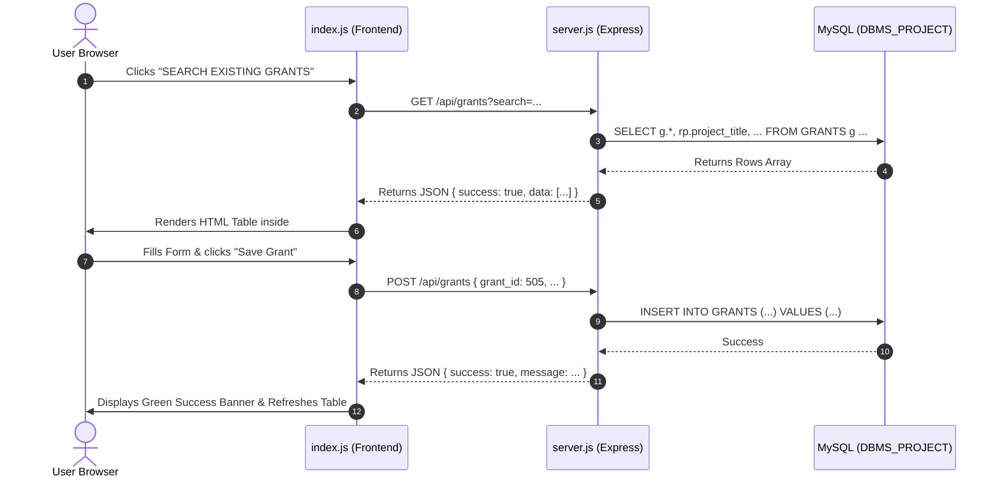

# Research Grant Management System — Codebase Walkthrough

This guide explains how each non-SQL file in this project is organized, what every function does, and how the frontend and backend communicate.

---

## 📁 Project Structure Overview

```text
miniproject_dbms/
├── server.js          # Express backend API & MySQL database connection
├── index.html         # Main web page layout (Header, Buttons, Display container)
├── index.js           # Frontend logic (renders forms, tables, calls backend APIs)
├── styles.css         # Minimal styling (cards, tables, forms, badges, buttons)
├── package.json       # Node.js project configuration, dependencies, and scripts
├── .env               # Database connection settings & port configuration
└── .env.example       # Template for .env configuration
```

---

## 1. `server.js` (Backend API & Database)

This file sets up the **Express.js server**, connects to your **MySQL database** via a connection pool, and exposes RESTful API endpoints for CRUD (Create, Read, Update, Delete) operations.

### Configuration & Setup
- **`dotenv.config()`**: Reads environment variables from [.env](file:///d:/miniproject_dbms/.env) (such as `DB_HOST`, `DB_USER`, `DB_PASSWORD`, `DB_NAME`, `PORT`).
- **`mysql.createPool({ ... })`**: Creates a reusable pool of database connections rather than opening and closing a single connection repeatedly.
- **`app.use(express.json())` & `app.use(express.static(__dirname))`**:
  - Parses incoming JSON request payloads sent by the frontend.
  - Automatically serves static frontend files (`index.html`, `styles.css`, `index.js`) to the browser.

---

### Functions & Route Handlers in `server.js`

#### `checkDbConnection()`
- **What it does**: Automatically runs when the server starts. It borrows a test connection from the pool to verify if MySQL is running and reachable.
- **Behavior**: If successful, it logs a green success message. If MySQL is not running or credentials are wrong, it logs a warning without crashing the server.

#### `GET /api/status`
- **What it does**: Health-check endpoint used by the frontend to see if the database is online.
- **Returns**: `{ connected: true }` if MySQL is connected, or `{ connected: false, message: ... }` if offline.

#### `GET /api/grants`
- **What it does**: Retrieves all grants from the `GRANTS` table.
- **Features**:
  - **Relational JOINs**: Uses `LEFT JOIN` on `GRANT_APPLICATION`, `RESEARCH_PROJECT`, `RESEACRHER`, and `FUNDING_AGENCY` so each grant row also shows the project title, researcher name, and funding agency name.
  - **Search Filtering**: If a `?search=...` query parameter is provided, it filters by grant ID, status, project title, researcher, or agency name using SQL `LIKE`.
  - **Resilience Fallback**: If related tables don't exist yet, it catches the error and cleanly falls back to `SELECT * FROM GRANTS`.

#### `GET /api/grants/:id`
- **What it does**: Retrieves a single grant by its primary key (`grant_id`).
- **Returns**: The grant object if found, or HTTP 404 if not found.

#### `GET /api/applications`
- **What it does**: Helper endpoint that queries the `GRANT_APPLICATION` table to return existing application IDs and requested amounts.
- **Purpose**: Used by the frontend insert/update forms so the user can easily pick a valid existing `application_id`.

#### `POST /api/grants`
- **What it does**: Inserts a new grant into the `GRANTS` table.
- **Input (JSON Body)**: `grant_id`, `application_id`, `approved_amount`, `approval_date`, `grant_status`.
- **Error Handling**:
  - Handles duplicate primary keys (`ER_DUP_ENTRY`) with a friendly message: *"A grant with ID ... already exists."*
  - Handles foreign key errors (`ER_NO_REFERENCED_ROW_2`) when an `application_id` does not exist in `GRANT_APPLICATION`.

#### `PUT /api/grants/:id`
- **What it does**: Updates an existing grant by `grant_id`.
- **Input (JSON Body)**: Updated `application_id`, `approved_amount`, `approval_date`, and `grant_status`.
- **Returns**: HTTP 200 on success, or HTTP 404 if the grant ID was not found.

#### `DELETE /api/grants/:id`
- **What it does**: Permanently deletes a grant record by `grant_id`.
- **Safety Handling**: Catches foreign key errors (`ER_ROW_IS_REFERENCED_2`) if child records exist in the `EXPENSE` table.

#### `GET /`
- **What it does**: Serves the main [index.html](file:///d:/miniproject_dbms/index.html) file to any browser visiting `http://localhost:3000`.

#### `app.listen(PORT, ...)`
- **What it does**: Starts listening for incoming web traffic on the specified port (default: `3000`).

---

## 2. `index.js` (Frontend Dynamic Logic)

This file contains the **Single Page Application (SPA)** client logic. It intercepts button clicks and dynamically renders forms or tables into `<div id="display"></div>` without reloading the page.

### Utility & Helper Functions

#### `setActiveButton(activeBtn)`
- **What it does**: Removes the `.active` styling from all 4 menu buttons and applies it to the currently selected button so the user knows which view is open.

#### `formatCurrency(amount)`
- **What it does**: Takes a raw numeric value (e.g. `75000`) and formats it using JavaScript's native `Intl.NumberFormat` into standard currency format (e.g. `$75,000.00`).

#### `formatDate(dateStr)`
- **What it does**: Formats SQL timestamps or date strings into clean `YYYY-MM-DD` strings for display and for HTML `<input type="date">` values.

#### `getStatusBadge(status)`
- **What it does**: Returns an HTML `<span>` badge with a color-coded CSS class:
  - Green for **Approved** and **Active**
  - Yellow for **Pending** and **Under Review**
  - Purple/Blue for **Completed**
  - Red for **Rejected**

#### `checkStatus()`
- **What it does**: Calls `/api/status` upon rendering any view. If MySQL is offline, it returns a non-intrusive yellow warning banner explaining how to start MySQL.

---

### Core View Renderers

#### `renderSearchGrants(searchTerm = "")`
- **Triggered by**: Clicking **SEARCH EXISTING GRANTS** (`#option2`), opening the app initially, or typing in the search bar.
- **What it does**:
  1. Renders the search box and "Refresh" / "Clear" buttons.
  2. Sends a `GET /api/grants?search=...` request to [server.js](file:///d:/miniproject_dbms/server.js).
  3. Builds an HTML table with columns: `Grant ID`, `App ID`, `Project Title`, `Researcher`, `Funding Agency`, `Approved Amount`, `Approval Date`, `Status`, and row-level `Actions`.
  4. Attaches click listeners to the inline **Edit** (pencil) and **Delete** (trash) buttons in each row.

#### `renderInsertGrant()`
- **Triggered by**: Clicking **INSERT NEW GRANT** (`#option1`).
- **What it does**:
  1. Requests available applications from `/api/applications` to populate a reference dropdown.
  2. Renders a form asking for `Grant ID`, `Application ID`, `Approved Amount`, `Approval Date`, and `Status`.
  3. When submitted, prevents the page from reloading (`e.preventDefault()`), validates the inputs, and sends `POST /api/grants`.
  4. Displays a success or error banner. Upon success, redirects back to the grants table after 1.2 seconds.

#### `renderUpdateGrant(prefillGrantId = null)`
- **Triggered by**: Clicking **UPDATE EXISTING GRANT** (`#option3`), or clicking the **Edit** icon in any table row.
- **What it does**:
  1. Has an inner function `fetchAndPopulate(id)` that calls `/api/grants/:id` and populates the form fields with existing data.
  2. Keeps `grant_id` locked as read-only (since primary keys should not be changed).
  3. On submit, sends a `PUT /api/grants/:id` request to update the database.

#### `renderDeleteGrant(prefillGrantId = null)`
- **Triggered by**: Clicking **DELETE EXISTING GRANT** (`#option4`), or clicking the **Delete** icon in any table row.
- **What it does**:
  1. Takes the Grant ID and asks the user for explicit confirmation via `window.confirm`.
  2. If confirmed, sends `DELETE /api/grants/:id`.
  3. Shows a success banner and refreshes the table.

---

## 3. `index.html` (User Interface Structure)

This file defines the minimal HTML5 skeleton:

- **`<head>`**:
  - Loads Google Font `Inter` for modern typography.
  - Loads Google Material Symbols Outlined for clean button icons.
  - Links to [styles.css](file:///d:/miniproject_dbms/styles.css).
- **`<div class="header">`**: Displays the title `"RESEARCH GRANT MANAGEMENT SYSTEM"`.
- **`<div class="options">`**: Houses the 4 main interaction buttons:
  - `<button id="option1">` — Insert New Grant
  - `<button id="option2">` — Search Existing Grants
  - `<button id="option3">` — Update Existing Grant
  - `<button id="option4">` — Delete Existing Grant
- **`<div id="display" class="display">`**: The empty mount point where [index.js](file:///d:/miniproject_dbms/index.js) dynamically renders forms, tables, and alert banners.
- **`<script src="index.js">`**: Included at the bottom of `<body>` to execute after HTML elements are parsed.

---

## 4. `styles.css` (Visual Design & Layout)

Provides clean, minimal styling adhering to the project's color palette without bloated frameworks:

- **Theme Colors**:
  - Background: Linear gradient (`#e0f2fe` to `#bae6fd`)
  - Primary Accent: Deep blue (`#0369a1`)
  - Dark Slate for Header/Buttons: (`#0f172a`)
- **Main Components**:
  - `button`: Dark slate buttons with smooth hover animations and elevation shadow.
  - `.options button.active`: Highlights the active tab with an outline and white background.
  - `.card`: Clean white floating card panel with rounded corners and subtle shadow.
  - `.grants-table`: Full-width table with a dark `#0f172a` header row and hover highlighting on rows.
  - `.form-grid`, `.form-group`, `.form-control`: Responsive inputs, dropdowns, and labels.
  - `.badge-*`: Rounded pill badges for statuses (Approved, Active, Pending, Completed, Rejected).
  - `.alert-*`: Friendly colored banners for feedback (`alert-success`, `alert-error`, `alert-warning`).

---

## 5. Configuration Files

### `package.json`
- **`"type": "module"`**: Tells Node.js to use ES module syntax (`import ... from ...` instead of `require`).
- **`"scripts"`**:
  - `npm start`: Runs `node server.js`.
  - `npm run dev`: Runs `nodemon server.js` for automatic reloads during development.
- **`"dependencies"`**:
  - `express`: Web server and routing framework.
  - `mysql2`: Fast MySQL driver supporting connection pools and async/await Promises.
  - `dotenv`: Loads environment variables from `.env`.
  - `nodemon`: Auto-restarting development server.

### `.env` & `.env.example`
Stores environment variables so sensitive database passwords are kept outside source code:
```env
PORT=3000
DB_HOST=localhost
DB_USER=root
DB_PASSWORD=
DB_NAME=DBMS_PROJECT
DB_PORT=3306
```

---

## 🔄 Complete Data Flow Summary


