# Research Grant Management System — Presentation Script

**Project Title:** Research Grant Management System  
**Course:** Database Management Systems (DBMS Mini Project)  
**Speakers:** Speaker 1 & Speaker 2  
**Estimated Time:** 7 – 10 minutes (Includes Live Demo)

---

## 🎭 Roles at a Glance

| Role | Focus Areas | Live Demo Action |
|---|---|---|
| **Speaker 1** | Introduction, Problem Statement, Relational Schema (10 Tables), Live UI Demo | Navigates the app, executes transactions |
| **Speaker 2** | 4 SQL Triggers, RBAC Security, Database Integrity, Technical Q&A | Explains the underlying MySQL operations & triggers firing |

---

## ⏱️ Timeline & Structure

```mermaid
gantt
    title Presentation Flow (8-10 Minutes)
    dateFormat  m
    axisFormat %M min
    section Introduction
    Motivation & Problem Statement :active, 0, 1
    section Database Design
    Relational Architecture & Schema :1, 3
    section DBMS Highlights
    4 Advanced SQL Triggers :3, 5
    section Demonstration
    Live System Demo & Role Walkthrough :5, 8
    section Wrap-Up
    Conclusion & Evaluator Q&A :8, 10
```



---

## 🎙️ Speech Script

### 1. Introduction & Motivation (0:00 – 1:30)

**[Speaker 1]**:
> "Good morning, respected professors and fellow students. Today, my partner and I are excited to present our Database Management Systems project: the **Research Grant Management System**.
>
> In major universities and research institutions, academic research is sponsored by diverse external bodies like the DST, SERB, and ISRO. Managing these grants typically involves multiple researchers, across diverse departments, handling multi-lakh budgets, strict compliance deadlines, and milestones.
>
> Most institutions face significant challenges:
> 1. **Budget leakage**, where project expenses accidentally exceed the sanctioned grant budget.
> 2. **Manual synchronization delays**, where project status is disconnected from milestone completion.
> 3. **Lack of accountability**, where grant modifications or budget adjustments lack an immutable audit trail.
>
> To solve this, we designed a centralized, role-aware database system built on top of **MySQL**, featuring **strict relational integrity, automated triggers, and role-based access control**."

---

### 2. Database Schema & Relational Design (1:30 – 3:30)

**[Speaker 2]**:
> "Let us look at the structural foundation in MySQL. We normalized our schema up to **Third Normal Form (3NF)** to eliminate data redundancy and prevent update/deletion anomalies.
>
> Our database `DBMS_PROJECT` comprises **10 relational tables**:
> 
> 1. `DEPARTMENT` and `RESEARCHER`: Captures academic hierarchy, where researchers belong to specific departments via foreign keys.
> 2. `RESEARCH_PROJECT`: Represents individual research initiatives led by a Primary Investigator.
> 3. `FUNDING_AGENCY` and `GRANT_APPLICATION`: Models the proposal phase where researchers apply for sponsorships.
> 4. `GRANTS`: The core financial entity containing sanctioned amounts, approval dates, and statuses.
> 5. `EXPENSE`: Tracks itemized expenditures linked to individual grants.
> 6. `MILESTONE`: Breaks projects into time-bound deliverables.
> 7. `USERS`: Implements secure authentication with role definitions — `Admin`, `Researcher`, and `Faculty`.
> 8. `AUDIT_LOG`: A dedicated auditing table that stores JSON snapshots of changes.
>
> All primary keys and foreign keys enforce referential integrity with cascading constraints to preserve parent-child consistency across researchers, projects, and allocations."

---

### 3. Core Highlight: 4 SQL Triggers (3:30 – 5:30)

**[Speaker 1]**:
> "Now, coming to the most critical feature of our database implementation: **Automated Business Logic via MySQL Triggers**. Rather than relying entirely on application code, we pushed data integrity guarantees directly into the database engine."

**[Speaker 2]**:
> "We implemented **4 distinct triggers** to handle automated rules:
>
> 1. **Trigger 1: Budget Guard (`BEFORE INSERT ON EXPENSE`)**
>    - *The Problem*: In a multi-user environment, race conditions can cause recorded expenses to exceed the approved grant ceiling.
>    - *Our Solution*: This trigger calculates the current cumulative expense sum for that grant. If `SUM(amount) + NEW.amount` exceeds `GRANTS.approved_amount`, the trigger fires a custom SQL exception using:
>      ```sql
>      SIGNAL SQLSTATE '45000'
>      SET MESSAGE_TEXT = 'BUDGET_EXCEEDED: Total expenses would exceed approved grant amount.';
>      ```
>      The transaction immediately rolls back at the database level!
>
> 2. **Trigger 2: Milestone-to-Project Auto Completion (`AFTER UPDATE ON MILESTONE`)**
>    - Whenever any milestone status changes, this trigger automatically counts the total milestones and completed milestones for that project.
>    - Once all milestones are marked 'Completed', the trigger automatically executes an `UPDATE` on `RESEARCH_PROJECT`, marking the entire project as 'Completed' without manual intervention.
>
> 3. **Trigger 3: Grant-to-Application Status Synchronization (`AFTER INSERT ON GRANTS`)**
>    - Guarantees transactional consistency. When an official grant record is inserted, the trigger automatically transitions the corresponding proposal in `GRANT_APPLICATION` to `'Approved'`.
>
> 4. **Trigger 4: Immutable Audit Logging (`AFTER UPDATE / DELETE ON GRANTS`)**
>    - Financial records require complete transparency. Any `UPDATE` or `DELETE` on the `GRANTS` table triggers an automatic insert into `AUDIT_LOG`.
>    - It packages the `OLD` and `NEW` records into native **MySQL JSON objects**, capturing timestamp, operation type, record ID, and field-level diffs."

---

### 4. Live Demonstration (5:30 – 8:00)

*(Speaker 1 shares the screen and operates the browser; Speaker 2 narrates the database events)*

**[Speaker 1]**:
> "Let's demonstrate the system live in action."  
> *(Navigates to `http://localhost:3000`)*
>
> "Notice we are automatically greeted with a secure login screen. Passwords are never stored in plain text — they are salted and hashed using `bcryptjs`."

**[Speaker 1]**:
> "First, let's log in as **Dr. Alan Turing** (`turing` / `researcher123`), who is a **Researcher**."  
> *(Logs in)*
>
> "Notice the UI adapts dynamically to his role:
> - As a Researcher, he only has permission to view existing grants.
> - Administrative buttons — *Insert New Grant*, *Update Grant*, *Delete Grant*, and *View Audit Log* — are completely removed from his dashboard.
> - Furthermore, the backend API scopes the SQL query so he only sees grants linked to his own research projects."

**[Speaker 1]**:
> "Now, let's log out and sign in as the **System Administrator** (`admin` / `admin123`)."  
> *(Logs in as Admin)*
>
> "As Admin, the full management console unlocks:
> - We have access to Insert, Update, Delete, and a dedicated **View Audit Log** button.
> - Currency amounts are formatted in Indian Rupees (₹ INR).
> - Let's view the existing grants table with real-time search filtering across researcher names, agencies, and project titles."

**[Speaker 2]**:
> "Now, let's demonstrate our **Audit Log Trigger**.  
> Speaker 1 will update Grant `#501` to change its status."  
> *(Speaker 1 clicks Edit on Grant #501, changes status from 'Approved' to 'Active', and clicks Save)*

**[Speaker 2]**:
> "The update succeeded. Now let's click **VIEW AUDIT LOG**."  
> *(Speaker 1 clicks Option 5: View Audit Log)*
>
> "Look at the newest entry in the table:
> - **Log ID**: Auto-generated.
> - **Table**: `GRANTS`.
> - **Action**: `UPDATE`.
> - **Old Values vs New Values**: You can see the exact JSON diff — previous status `'Approved'` changed to `'Active'`.
> This was populated automatically by our SQL trigger `trg_grant_audit_update`!"

---

### 5. Conclusion & Architecture Summary (8:00 – 9:00)

**[Speaker 1]**:
> "To summarize our technical stack:
> - **Database Layer**: MySQL 8.0 with InnoDB engine for ACID compliance, Foreign Key cascades, and 4 triggers.
> - **Backend Service**: Node.js & Express with connection pooling, session-based authentication, and role authorization middleware.
> - **Frontend Client**: Modern Vanilla JavaScript Single Page Application with responsive cards, live feedback banners, and dynamic DOM rendering.
>
> By enforcing business rules directly inside the MySQL database layer via triggers, our application maintains 100% data integrity regardless of how records are manipulated."

**[Speaker 2]**:
> "Thank you for your time and attention. We would now be glad to answer any questions or demonstrate specific queries and triggers."

---

## 💡 Anticipated Evaluator / Viva Questions & Answers

### Q1: Why did you use SQL Triggers instead of writing the checks in Node.js/Express?
> **Answer**:  
> *"Application-level checks can be bypassed if an administrator or script modifies the database directly (e.g., via MySQL Workbench, CLI, or an external ETL pipeline). By placing the constraints inside SQL Triggers (`BEFORE INSERT` and `AFTER UPDATE`), the database guarantees data consistency and budget limits regardless of which client connects."*

### Q2: What happens when the Budget Guard trigger fires?
> **Answer**:  
> *"The trigger evaluates `IF (current_total + NEW.amount) > budget_limit`. If violated, it raises `SIGNAL SQLSTATE '45000'` with our custom message `BUDGET_EXCEEDED`. Because this is a `BEFORE INSERT` trigger, MySQL immediately aborts the insert statement and raises an error, ensuring that no invalid expense row is ever committed."*

### Q3: How is password security handled?
> **Answer**:  
> *"We use `bcryptjs` with 10 salt rounds. Passwords are never stored as plain text. During login, `bcrypt.compare()` validates the input against the stored one-way hash. User sessions are tracked using HTTP-only cookies with server-side session state."*

### Q4: How does role-based scoping work on the backend?
> **Answer**:  
> *"When a user queries `/api/grants`, the server inspects the session user. If the role is `Researcher`, it appends `WHERE r.researcher_id = ?` to the SQL query. If `Faculty`, it filters by `department_id`. If `Admin`, no filter is applied. Write endpoints (`POST`, `PUT`, `DELETE`) are guarded by `requireRole('Admin')` middleware."*
